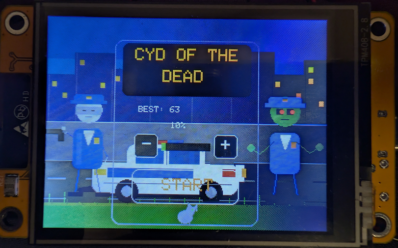

# CYD of the Dead

A small touchscreen rail-shooter prototype for the ESP32-based CYD (Cheap
Yellow Display). Zombie officers emerge in five original scenes—an alley,
police station, ballroom, backyard, and tavern—and approach in three lanes.
Tap them on the screen to shoot, protect the bystanders, and build your high
score.



## How to play

- The title screen features an animated, armed police officer on the left and
  a zombie that looks back and forth on the right. In front of the city
  skyline, the side-view police car occasionally drives from left to right.
  Individual house lights switch on and off infrequently, and the cat walks to
  a random point at the center or edge for up to 3.5–7 seconds, then sits for
  a random 1.8–7 second pause before choosing its next direction.
- Tap **Start** on the title screen.
- Zombies emerge through scene windows and doors before advancing toward you.
  They include police officers and undead in suits or dresses; police zombies
  and scene bosses telegraph and shoot, and each bullet that lands costs one
  life. Stop every zombie before it reaches you.
- Up to five zombies can appear at once. Each zombie is randomly assigned one
  of three distinct shambling, lurching, or reaching animations. Up to three
  peaceful civilians or animals can be on screen at once.
- Choose Easy (10 lives) or Hard (5 lives) in the title menu. Hard mode doubles
  the police-zombie share of spawns, and officers can shoot after one second.
- Brutes take five body hits and move slowly; runners move quickly, while
  peekers briefly watch from windows before moving into a lane.
- Every scene ends with a boss. Its chest weak point opens and closes; land
  five hits on the glowing chest weak point or three headshots to defeat it.
  Each scene takes 20 defeats,
  including the boss, and defeating the fifth scene's boss wins the game.
- A headshot defeats a regular zombie in one hit. Regular torsos take three
  hits, and brutes take five; wounds appear as they take damage.
- Consecutive defeats build a combo for extra points. Headshots also earn bonus
  points, while a miss or a civilian hit breaks the combo.
- The player has a ten-round magazine. Every shot uses one round, including
  missed shots. Remaining cartridges are shown at the lower left; tap
  **RELOAD** at the lower right to refill the magazine. Reloading does not
  fire a shot.
- Shots can damage the station scenery, leaving visible bullet cracks. These
  scenery hits do not score. A shot on an officer's cap knocks it off without
  defeating the officer or awarding a point.
- Background props—including windows, monitors, bottles, bins, and a
  chandelier—break visibly when hit. Broken props remain damaged for the
  current scene, and scenery hits never add points.
- Every 20 defeated zombies advances to the next scene with a short animated
  transition. Defeat the boss in each of the five scenes to win.
- Dogs, cats, men, women, and children may cross the scene. Shooting a
  bystander costs one life and does not award points.
- Original buzzer tones accompany shots, hits, and lost lives. Headshots and
  torso hits have different impact tones and animated bursts.
- Every ten zombies defeated advances the wave; later waves spawn zombies
  more frequently and rotate between headshot, combo, and elimination
  objectives. Completing an objective awards bonus points.
- Adjust buzzer volume in the title menu with **−** and **+**; the setting is
  saved on the CYD, and each adjustment plays an audible preview.
- Each zombie that reaches the foreground costs one life. Game Over shows the
  run's score, defeats, headshots, best combo, hit accuracy, and furthest scene;
  tap **PLAY AGAIN** to immediately restart with the selected difficulty.
- Your high score is saved in the CYD's non-volatile preferences as soon as a
  new record is reached.
- Original, synthesized retro-style buzzer music plays once on the title and
  Game Over screens, with extended melodies and a separate celebratory melody
  after completing all five scenes. Reloading plays a short two-note sound.
- Scene floors are drawn to match their locations: asphalt in the alley,
  concrete at the station, wood in the ballroom and tavern, and grass in the
  backyard. The alley and backyard have visible night skies.
- Defeat 100 zombies to complete all five scenes and reach the victory
  screen, where a celebrating crowd gathers in front of the town hall under
  animated fireworks. Tap the screen to return to the title.
- The Game Over screen features a celebrating zombie officer animated on the
  right side of the display.

## Hardware

Configured for an ESP32 CYD with a 2.8-inch, 240 x 320 ST7789 display, an
XPT2046 touchscreen, and a buzzer on GPIO 26, with the same display and touch
pin setup used by this project's `include/cyd_user_setup.h`. CYD boards have
multiple revisions; verify the display controller and pinout for your
particular board before flashing.

## Build and upload

1. Install [Visual Studio Code](https://code.visualstudio.com/) and the
   **PlatformIO IDE** extension.
2. Clone this repository and open its folder in VS Code:

   ```sh
   git clone https://github.com/miquatsm-source/CYD-of-the-death.git
   ```

3. Connect the CYD over USB with a data-capable cable.
4. Build and upload using the PlatformIO buttons, or run these commands from
   the project folder:

   ```sh
   pio run -e esp32dev-fast
   pio run -e esp32dev-fast -t upload
   ```

   PlatformIO downloads the ESP32 platform and libraries on the first build.
   If upload cannot find the board, select its serial port in PlatformIO. Some
   boards require holding **BOOT** while the upload begins.

## Touchscreen calibration

On first boot, touch and release each of the four calibration targets.
Calibration is stored in the ESP32 and reused on later boots.

## Configuration

- Default PlatformIO environment: `esp32dev-fast`
- `esp32dev-fast` uses 80 MHz display SPI; `esp32dev` uses the safer 40 MHz
  setting. 80 MHz is an overclock and can cause artifacts or instability on
  some boards.
- Gameplay is drawn into an 8-bit off-screen frame buffer and sent to the
  display once per frame to avoid showing the intermediate full-screen redraw.
- The police station, uniforms, sound effects, music, and animations are
  original graphics and synthesized tones made for this project.
- Scene backgrounds use detailed, hand-drawn pixel-art shapes and perspective
  on the CYD display rather than photographic image assets.
- Framework: Arduino for ESP32
- Display library: TFT_eSPI
- Touch library: XPT2046_Touchscreen
- CYD display and pin setup: `include/cyd_user_setup.h`
